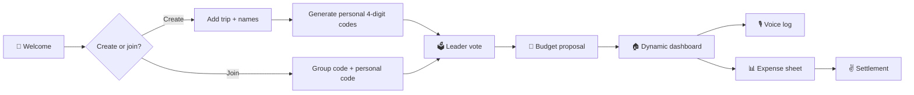

<div align="center">

# 🪩 kharcha.party

### Paisa ka hisaab, dosti ke saath.

**The playful group-trip expense tracker for people who are tired of hearing _“bhai tu de de, baad mein dekh lenge.”_**

[](https://expo.dev/)
[](https://reactnative.dev/)
[](https://fastify.dev/)
[](https://www.typescriptlang.org/)
[](LICENSE)

`Android-first` · `Roman Urdu microcopy` · `Realtime-ready` · `No awkward maths`

</div>

---

## ✨ The scene

Four friends go on a trip. Ali pays for dinner. Sara books the hotel. You fill the fuel tank. Hamza somehow only buys snacks. Three days later, nobody remembers who owes whom.

**kharcha.party remembers.**

- 💸 Track group and individual spending
- 🗳️ Elect a trip leader — ties trigger a revote, because dosti bachani hai boss
- 🎯 Propose and lock per-person budgets
- 🔐 Login with a shared group ID plus a personal 4-digit invitation code
- 🎙️ Turn transcripts such as `Hotel 12000 sab ke liye` into expense records
- ✅ Let the leader approve traveller expense requests
- 📊 View the full sheet, activity, balances, and budget progress
- ✌️ Calculate the smallest set of settlement payments
- ⚡ Receive live group updates over authenticated WebSockets

## 🎨 Vibe check

| Role | Colour | Hex |
| --- | --- | --- |
| After-midnight background | Near black | `#11100F` |
| Cards | Espresso | `#1D1B19` / `#282522` |
| Primary action | Lime | `#D6F36A` |
| Friendly warning | Orange | `#FF8C5A` |
| Secondary accent | Purple | `#A994F7` |

The interface uses big typography, rounded cards, playful emojis, and Roman Urdu/Hinglish copy designed for Android phones.

## 🧭 Product flow



## 🔐 Invitation login

The leader adds member names. The backend returns a separate four-digit code beside every name:

| Member | Personal code |
| --- | --- |
| Ali | `0834` |
| Sara | `8659` |
| Hamza | `7438` |

Members authenticate with the shared group code and their own personal code:

```json
{
  "groupCode": "KHP-M4REL8",
  "inviteCode": "8659"
}
```

The database stores only a group-scoped HMAC hash. Plain codes are returned when a member is created or when the leader rotates a lost code. Login attempts are rate-limited, and a reset invalidates the old code immediately.

## 🏗️ Architecture

```text
kharcha-party/
├── mobile-app/                 # Expo + React Native + Expo Router
│   ├── src/app/                # Screen routes
│   ├── src/components/         # Shared mobile UI primitives
│   ├── src/data/               # Prototype data
│   ├── src/state/              # Typed local state
│   └── src/theme.ts            # Colour, spacing, and radius tokens
├── backend/                    # Fastify + TypeScript API
│   ├── src/db/                 # SQLite schema + repository boundary
│   ├── src/modules/groups/     # Members, voting, invite codes, budgets
│   ├── src/modules/expenses/   # Expenses, approval, voice parsing
│   ├── src/modules/realtime/   # Authenticated WebSocket events
│   ├── src/modules/settlements/ # Balance and payment calculation
│   └── test/                   # End-to-end API flow tests
└── .github/workflows/ci.yml    # Mobile + backend quality gate
```

The backend keeps HTTP, domain, and persistence concerns separate. SQLite makes local setup instant; the repository boundary provides a clear migration path to managed PostgreSQL when horizontal scaling is needed.

> [!NOTE]
> The mobile interface currently runs as a polished local-data prototype. The dynamic backend is complete and independently runnable; wiring the mobile state layer to these APIs is the next integration milestone.

## 🚀 Run it locally

### Prerequisites

- Node.js 22+
- npm 11+
- Android Studio with an emulator, or an Android phone

### 1. Start the backend

```bash
cd backend
cp .env.example .env
npm install
npm run dev
```

The API starts at `http://localhost:4000`.

```bash
curl http://localhost:4000/health
```

### 2. Start the mobile app

Open a second terminal:

```bash
cd mobile-app
npm install
npm run android
```

For a quick browser preview:

```bash
npm run web
```

## 🔌 API taste test

Create a group and generate member invitation codes:

```bash
curl -X POST http://localhost:4000/api/v1/groups \
  -H 'Content-Type: application/json' \
  -d '{
    "name": "Hunza Scene 2026",
    "creatorName": "Ali",
    "memberNames": ["Sara", "Hamza", "You"]
  }'
```

Login with a personal code:

```bash
curl -X POST http://localhost:4000/api/v1/auth/invite \
  -H 'Content-Type: application/json' \
  -d '{"groupCode":"KHP-ABC123","inviteCode":"0427"}'
```

See the complete endpoint table and request examples in the [backend guide](backend/README.md).

## 🧪 Quality gates

### Mobile

```bash
cd mobile-app
npm run typecheck
npm run lint
npm run export:android
```

### Backend

```bash
cd backend
npm run check
```

`npm run check` runs strict TypeScript, type-aware ESLint, end-to-end API tests, and a production build. The tested flow covers group creation, invitation login, voting, budget locking, traveller requests, leader approval, voice parsing, dashboard totals, code rotation, and settlements.

## 🛡️ Backend guardrails

- JWT member sessions scoped to one group
- HMAC-hashed personal invitation codes
- Rate-limited login attempts
- Zod validation at every API boundary
- Leader-only budget locking and expense approval
- SQLite foreign keys and transaction-safe writes
- Helmet security headers and configurable CORS
- Integer PKR amounts to avoid floating-point money errors
- Graceful shutdown and stable error envelopes

## 🗺️ Roadmap

- [x] Android-first interactive UI
- [x] Dynamic groups, members, voting, and budgets API
- [x] Personal invitation-code login
- [x] Expense approval and settlement engine
- [x] Realtime WebSocket event channel
- [ ] Connect mobile screens to the API client
- [ ] Add real microphone capture and speech-to-text provider
- [ ] Move production persistence to PostgreSQL
- [ ] Add push notifications and payment deep links

## 🤝 Contributing

Ideas, fixes, and better microcopy are welcome. Read [CONTRIBUTING.md](CONTRIBUTING.md), open an issue, and send a focused pull request.

<div align="center">

Built for trips, shaadis, and that one dost who always says **“kal de dunga.”** 💸

</div>
